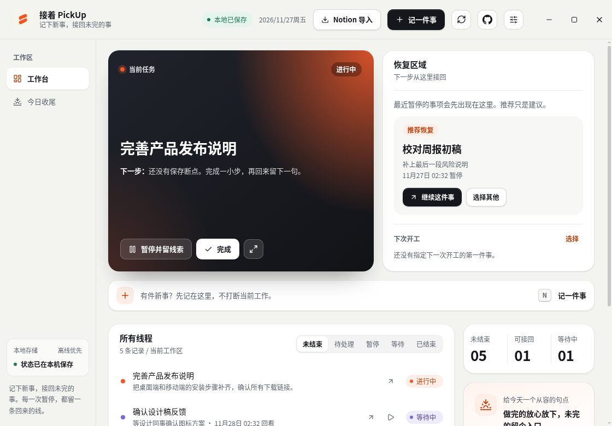
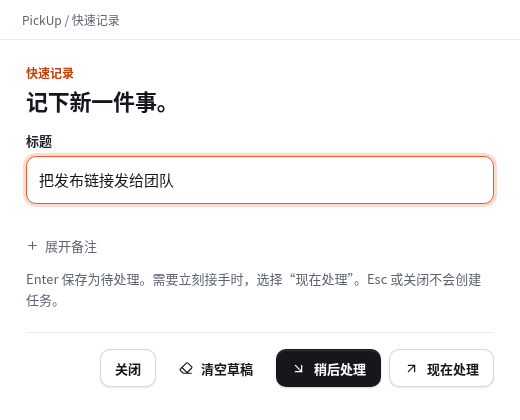
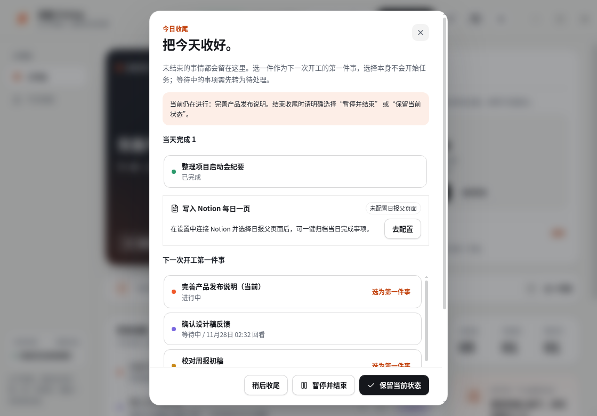
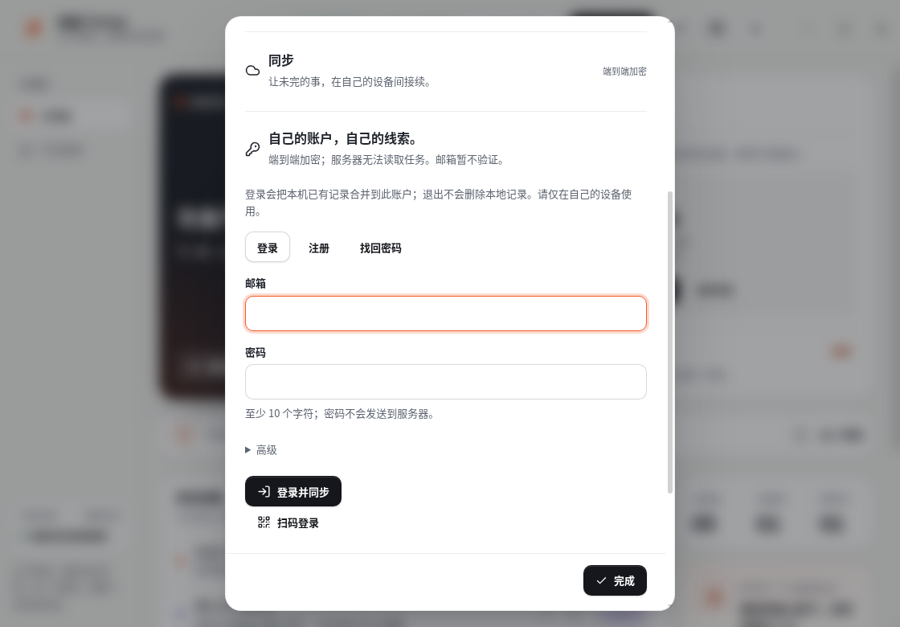
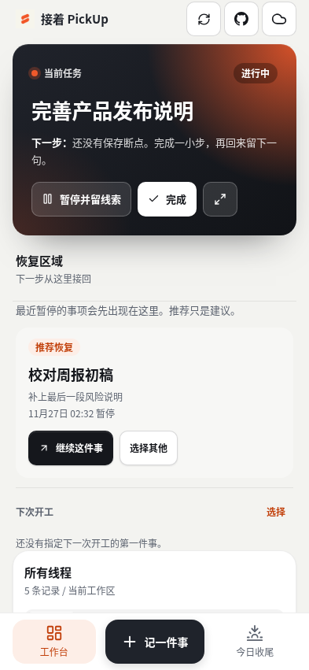

# 接着 PickUp

**记下新事，接回未完的事。** PickUp 是一款免费、开源、离线优先的个人任务助手，支持 Windows、Android 和 iPhone。临时有事，先用快速记录收下；需要切换任务时，留一句「做到哪了、下一步是什么」，回来就不用重新理思路。

[下载安装](https://github.com/yoob52/PickUp/releases/latest) · [产品截图](#产品截图) · [自托管同步](#自托管同步)

## 产品截图

**桌面工作台**：在同一屏查看当前任务、恢复线索和待处理事项。



| 快速记录 | 今日收尾 |
| :---: | :---: |
|  |  |

| 桌面悬浮入口 | 账户与同步 | 手机工作台 |
| :---: | :---: | :---: |
| <br> |  |  |

截图使用示例任务：桌面图来自 Electron 应用，手机图来自以手机视口运行的移动端 Web 构建。

## 主要功能

- **快速记录**：新任务可留待稍后处理，也可立即开始。Windows 支持独立记录窗口、可拖动的悬浮球、托盘和全局快捷键（默认 `Ctrl + Alt + N`，可修改）。关闭主窗口会收起到托盘；如需退出，在托盘菜单选择「完全退出」。
- **暂停与恢复**：暂停或切换时可记录当前进展、下一步和参考信息；等待中的事项可以设置回看时间。
- **今日收尾**：回顾当天已完成的事项，为下次开工选一件事，但不会自动开始任务。
- **账户与同步**：不用注册也能离线使用。登录同一个账户后，可在电脑和手机之间端到端加密同步任务；手机已登录时可扫码登录电脑。请离线保存注册时生成的恢复码。
- **Notion 集成（桌面）**：连接自己的 Notion 集成后，可导入待办、选择是否回写完成状态，并把今日收尾中的已完成事项写入 Notion 日报。
- **检查更新与项目入口**：可从应用内检查更新或打开 GitHub 仓库。Windows 和 Android 可从应用内发起安装更新；iPhone 仍需对新 IPA 自行签名并覆盖安装。

## 下载与安装

打开 [GitHub Releases](https://github.com/yoob52/PickUp/releases/latest)，在 **Assets** 中选择设备对应的安装包：

| 平台 | 安装包 | 安装方式 |
| --- | --- | --- |
| Windows 10 / 11（x64） | `PickUp.Setup.<版本>.exe` | 运行安装程序；同页的 `SHA256SUMS.txt` 可校验 Windows 安装包。 |
| Android 8.0 及以上 | `app-release.apk` | 在手机上打开 APK，按系统提示允许当前来源安装应用。 |
| iPhone（iOS 17.4 及以上） | `PickUp-<版本>-unsigned.ipa` | 不经 App Store；使用免费 Apple ID 自行签名，每 7 天续签。详见 [iOS 侧载指南](docs/IOS-INSTALL.md)。 |

Windows 安装包通过本仓库的 [GitHub Actions 发布流程](.github/workflows/release.yml) 从源码构建。可在 **设置 → 应用 → 已安装的应用** 中卸载 PickUp，或运行安装目录中的 `Uninstall PickUp.exe`。卸载会保留 `%APPDATA%/PickUp` 下的本机数据；如需彻底删除，卸载后再手动删除该目录。

## 自托管同步

应用内置同步服务地址 `https://pickup.3352378.xyz`，不必自建服务即可使用同步。如需自托管，可使用 Docker Engine 和 Compose v2 运行同步中继。客户端加密任务后再上传；中继不保存任务明文，但仍保存账户邮箱等服务所需的信息。

用仓库自带的 Caddy 启用 HTTPS：准备一个指向服务器的域名，开放 TCP 80 和 443，然后在仓库根目录执行：

```sh
cd server
cp .env.example .env
chmod 600 .env
# 编辑 .env，将 PICKUP_DOMAIN 设置为你的域名（不带 https://）
docker compose --profile https up -d
curl --fail https://sync.example.com/healthz  # 替换为你的域名
```

看到 `{"ok":true}` 后，在桌面 **设置 → 同步**（手机：顶栏云图标）展开 **高级**，把「账户服务器」改为你的 HTTPS 地址，再注册或登录该服务上的账户。已有反向代理、从源码构建镜像或需要备份与升级时，请参阅 [同步中继部署指南](docs/SYNC-SERVER.md)。不要将中继的明文 HTTP 端口暴露到公网。

## 开发与测试

使用 Node.js **24.12.0** 和 npm **11.6.2**，在仓库根目录执行：

```sh
npm ci
npm run dev
```

`npm ci` 会安装 Electron 运行时并准备匹配的 SQLite 原生模块。首次安装需访问 npm 和官方二进制下载源。Windows 开发数据位于 `%APPDATA%/PickUp-development/data/pickup.sqlite`。测试使用独立的数据目录；不要并行执行依赖安装和构建或测试。

| 命令 | 用途 |
| --- | --- |
| `npm run build` / `npm run build:mobile` | 构建 Electron 应用 / 移动端 Web 资源 |
| `npm run check` | 类型检查、格式检查、单元与组件测试 |
| `npm run test:integration` / `npm run test:e2e` | 验证真实 Electron worker 与 SQLite / 执行桌面端到端测试 |
| `npm run test:mobile` | 执行移动端交互、持久化和同步测试 |
| `npm run pack` / `npm run dist` | 在 Windows 生成 x64 解包产物 / NSIS 安装包 |
| `npm ci --prefix server`、`npm run server:test` | 安装独立的同步服务依赖并运行服务端测试 |

**代码位置**：`src/main/`、`src/preload/` 和 `src/worker/` 分别负责 Electron 主进程、IPC 桥接和桌面 SQLite；`src/renderer/` 与 `src/mobile/` 分别存放共享界面和移动端入口，`src/shared/` 存放共享契约和任务规则。Android 和 iOS 工程分别位于 `android/`、`ios/`；同步中继位于 `server/`。

**更多文档**：[工程说明与打包](docs/ENGINEERING.md) · [软件架构](docs/ARCHITECTURE.md) · [产品需求](docs/PRD.md) · [验证记录](docs/VALIDATION.md) · [技术负责人计划](docs/TECH-LEAD-PLAN.md)

## 隐私

无需账户即可在设备上保存任务并离线使用；Windows 的本机 SQLite 数据位于 `%APPDATA%/PickUp`。登录并启用同步后，任务内容在客户端加密，中继无法读取任务明文。配置并使用 Notion 集成时，桌面应用会直接与 Notion 交换所选内容。应用也会联网检查 GitHub Releases 是否有新版本。

## Code signing policy

Free code signing provided by [SignPath.io](https://about.signpath.io/), certificate by [SignPath Foundation](https://signpath.org/).

- Committers and reviewers: [yoob52](https://github.com/yoob52)
- Approvers: [yoob52](https://github.com/yoob52)

Every change from people other than the committers goes through a pull request reviewed by a committer. Only installers built by the [release workflow](.github/workflows/release.yml) from this repository are submitted for signing, and each signing request is approved manually by an approver.

## 许可证

[MIT](LICENSE)
